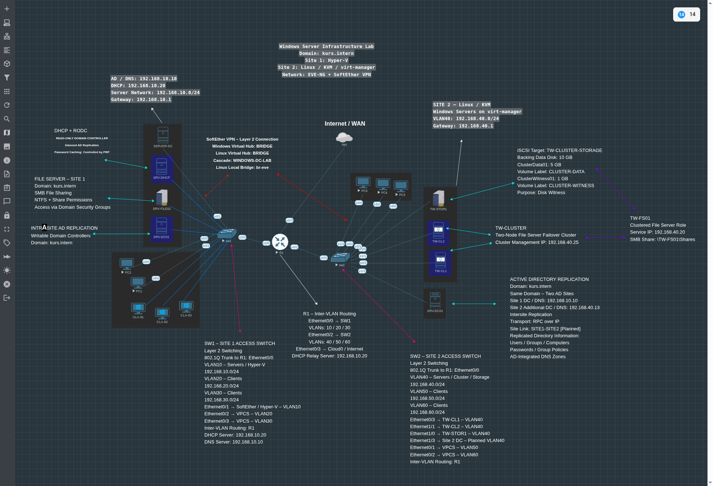
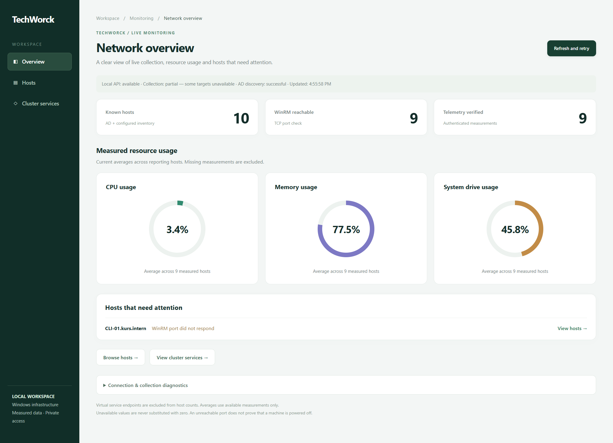

# My Windows Server lab across Hyper-V and Linux

I started with Windows Server VMs on a Hyper-V internal switch. Getting them to communicate with EVE-NG on a separate Linux host became a project of its own. Once that connection worked, I extended the lab to two sites, six VLANs, another domain controller, shared iSCSI storage and a two-node file server cluster.

This repository is my record of that work: the network I built, the mistakes I investigated, and the results I can show. The earlier, smaller version is still here so the development is visible.

**Built and documented by Vahid Rahmani.** This is my learning environment, not a customer deployment.

[My German project report — PDF, 15 pages](docs/reports/Abschlussprojekt_Vahid_Rahmani_DE.pdf) · [Full EVE-NG topology](assets/two-site-topology.png) · [Deutscher Projektüberblick](docs/projektbericht.de.md)

## What changed since the first version

The first version focused on Hyper-V → SoftEther → Linux bridge → EVE-NG, followed by routing, DHCP relay and NAT exercises. It used a smaller three-network design.

The current version adds:

- Two logical AD sites in the same **kurs.intern** domain, with an additional DC at Site 2.
- VLANs 10/20/30 behind SW1 and VLANs 40/50/60 behind SW2.
- **TW-CL1** and **TW-CL2**, backed by the iSCSI target on **TW-STOR1**.
- Separate identities for cluster management and the clustered file service.
- A local monitoring dashboard with recorded host measurements and service checks.
- A German report connecting the Windows Server course tasks A1–A13 to the larger lab.

The report, drawing and screenshots record the lab on **17 October 2026**. Older notes often use example addresses and describe an earlier stage. They are useful history, not the current network plan.

## Start with my actual lab

| Material | What it shows |
| --- | --- |
| [German project report](docs/reports/Abschlussprojekt_Vahid_Rahmani_DE.pdf) | My decisions, course tasks, diagrams, troubleshooting and documented tests |
| [Original working topology](assets/two-site-topology.png) | Both sites, links, VLANs, shared storage and cluster identities |
| [Current architecture](docs/architecture.md) | How transport, switching, routing, AD and storage fit together |
| [Evidence and open checks](docs/evidence.md) | What the supplied screenshots establish and what still needs a test record |
| [Validation checklist](docs/test-plan.md) | The checks I use at each layer |
| [Earlier build story](docs/complete-project-case-study.md) | The smaller setup from which this version developed |

Click the full drawing to inspect the original:

Some labels predate the dashboard capture. The Site 2 DC is labelled **SRV-DC01** in the drawing, while its recorded Windows name is **SRV-DC02.kurs.intern**, at **192.168.40.13**. The Site Link and DC port still carry planning labels. I have kept the original drawing and explained the difference instead of treating it as a configuration export.

## How I connected the two hosts

On Windows, the VMs use the internal switch **DC-LAB**. SoftEther carries the lab segment to **br-eve** on Linux. EVE-NG attaches the bridge to the simulated network. R1 handles the routed gateways; SoftEther provides Layer 2 transport.

Both switch uplinks are trunks in this version:

| R1 connection | Destination | VLANs or purpose |
| --- | --- | --- |
| Ethernet0/0 | SW1 Ethernet0/0 | 10 / 20 / 30 |
| Ethernet0/2 | SW2 Ethernet0/0 | 40 / 50 / 60 |
| Ethernet0/3 | WAN / Cloud0 | Outside connection |

| Site | VLANs | Private subnets |
| --- | --- | --- |
| Site 1 — Hyper-V | 10 / 20 / 30 | 192.168.10.0/24, 192.168.20.0/24, 192.168.30.0/24 |
| Site 2 — Linux/KVM | 40 / 50 / 60 | 192.168.40.0/24, 192.168.50.0/24, 192.168.60.0/24 |

R1 uses **.1** in each subnet as its gateway. These are the actual private allocations shown in my report and drawing. The older runbooks retain teaching examples. No passwords, VPN secrets, credential exports, keys or VM disks are included.

## Adding shared storage and the cluster

| System or identity | IPv4 | Purpose |
| --- | --- | --- |
| TW-STOR1 | 192.168.40.10 | iSCSI target |
| TW-CL1 | 192.168.40.11 | Cluster node 1 |
| TW-CL2 | 192.168.40.12 | Cluster node 2 |
| SRV-DC02 | 192.168.40.13 | Site 2 DC |
| TW-FS01 | 192.168.40.20 | Virtual file server |
| TW-CLUSTER | 192.168.40.25 | Cluster management |

The storage work uses a 10 GB backing data disk, a 5 GB data LUN and a 1 GB witness LUN. TW-STOR1 is not a third cluster node. TW-FS01 and TW-CLUSTER are not extra VMs.

I had to understand these differences before the configuration made sense. Two disks having the same owner is not automatically a fault. A witness is not another copy of the user files. Two cluster guests on one physical Linux host also do not protect against losing that host or the single storage server.

## What my monitoring run shows

The recorded run shows **10 known hosts and authenticated telemetry for 9**. CLI-01 has no WinRM response. The dashboard keeps that state visible rather than presenting missing data as zero or declaring the machine switched off.

The [host list](assets/screenshots/monitoring-hosts.png) contains devices from both sites. The [cluster services view](assets/screenshots/monitoring-cluster-services.png) shows TW-FS01's SMB endpoint as reachable and TW-CLUSTER's role state as unverified.

The application code is maintained in my separate [Monitoring Dashboard repository](https://github.com/Vahid-Rahmani/Automated-Hybrid-Network-Monitoring-Dashboard). These images show the local run used for this report.

An open SMB port is not a successful file-access test. Two nodes showing Up is not a failover result. The [evidence page](docs/evidence.md) keeps those checks separate.

## The parts that took troubleshooting

**The duplicate gateway.** The Hyper-V host also had 192.168.10.1. A ping could receive a Windows reply instead of R1's reply. Comparing MAC addresses helped identify it. The host management address was moved towards .254, leaving .1 for the router.

**A link that looked up but carried no expected traffic.** I checked ARP, the MAC table and packet counters, then captured traffic on br-eve. Seeing Hyper-V requests arrive narrowed the search. Rebuilding the VPN was not the right first response to every failed ping.

**DHCP beyond the local subnet.** An active scope was only part of the problem. Relay, the scope's router option and the server's return path all had to fit the client VLAN.

**Shared disks that did not appear.** After changing the iSCSI setup, I checked the target connection and rescanned the disks before the 5 GB and 1 GB LUNs became visible.

The earlier [troubleshooting timeline](docs/troubleshooting-timeline.md) and [reflection](docs/journey-reflection.md) preserve the first build, including assumptions that later changed.

## What still needs its own evidence

The course tasks are recorded as completed in my project workflow. This repository does not yet contain a screenshot for every task. A current AD replication report, an automatic failover followed by access to the unchanged share, and a restore result still need separate evidence here.

The single Linux host and storage server remain failure points. VLANs alone do not enforce access restrictions. I do not present this lab as an Azure deployment, an audited security design or a production handover.

## Repository map

- **assets/** — current overview, original EVE drawing and earlier diagrams.
- **assets/screenshots/** — the three monitoring captures.
- **docs/reports/** — my German PDF report.
- **docs/projektbericht.de.md** — my short project account in German.
- **docs/architecture.md**, **evidence.md**, **test-plan.md** — current design and validation.
- **docs/archive/** — the earlier architecture and test plan.
- **configs/** — earlier example commands, not live six-VLAN configuration exports.

I have kept the earlier work for comparison. The [current architecture](docs/architecture.md) is the starting point for this version.
