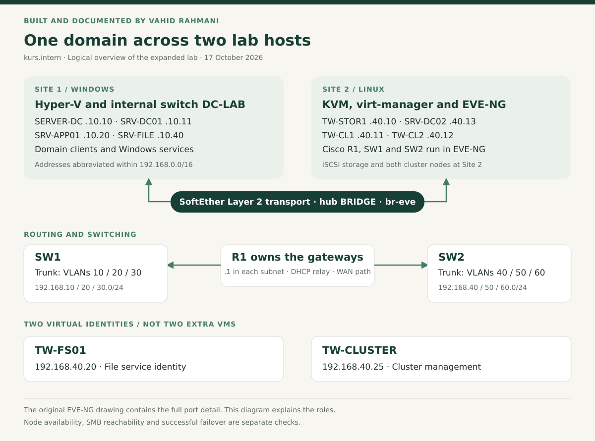

# Current two-site architecture

This describes the expanded lab recorded on 17 October 2026. The [earlier architecture](archive/architecture-first-version.md) is retained for comparison. Its three-network design is not the current topology.

## Hosts and transport

The Windows host runs Hyper-V and internal switch DC-LAB. Linux runs KVM/QEMU, virt-manager, EVE-NG and the SoftEther bridge. The cluster nodes are KVM guests; R1, SW1 and SW2 are EVE-NG nodes.

SoftEther joins the Hyper-V lab segment to Linux bridge br-eve through hub BRIDGE and Cascade WINDOWS-DC-LAB. Service state, local bridge state and Cascade state are separate checks. Operating and Online (Established) were recorded, followed by an R1-to-DC ping test.

The tunnel is bidirectional. It does not replace the VLAN gateways. The EVE NIC and Cloud/pnet attachment still have to match br-eve. A bridge forwarding Ethernet frames does not need its own host IP.

## Routing and VLANs

| Link | Role |
| --- | --- |
| R1 Ethernet0/0 ↔ SW1 Ethernet0/0 | Trunk for 10 / 20 / 30 |
| R1 Ethernet0/2 ↔ SW2 Ethernet0/0 | Trunk for 40 / 50 / 60 |
| R1 Ethernet0/3 ↔ WAN / Cloud0 | Outside connection |

R1 uses routed subinterfaces with gateway 192.168.&lt;VLAN&gt;.1/24. SW1 and SW2 provide Layer 2 switching.

The working drawing assigns SW2 Ethernet0/3 to TW-CL1, Ethernet1/1 to TW-CL2 and Ethernet1/0 to TW-STOR1, all in VLAN 40. Ethernet1/3 is the Site 2 DC attachment, still marked planned in the drawing. Ethernet0/1 and Ethernet0/2 serve VPCS in VLANs 50 and 60.

These are diagrammed attachments, not a switch configuration export. Multiple external connections to the same Linux bridge require a loop check.

## Windows identities in the dashboard snapshot

| DNS identity in kurs.intern | IPv4 | Recorded role |
| --- | --- | --- |
| SERVER-DC | 192.168.10.10 | DC and primary DNS address |
| SRV-DC01 | 192.168.10.11 | Additional DC |
| SRV-APP01 | 192.168.10.20 | Server; DHCP address in the drawing |
| SRV-FILE | 192.168.10.40 | Server; file service in the design |
| TW-STOR1 | 192.168.40.10 | iSCSI target |
| TW-CL1 | 192.168.40.11 | Cluster node |
| TW-CL2 | 192.168.40.12 | Cluster node |
| SRV-DC02 | 192.168.40.13 | Site 2 DC |
| CLI-01 | 192.168.10.102 | Client, no WinRM response |
| CLI-03 | 192.168.10.100 | Client with telemetry |

VM names, diagram labels and Windows DNS names can differ. The drawing includes representative VPCS and older labels; it is not the dashboard's host inventory.

## AD, DNS and DHCP

Both sites use kurs.intern. The documented layout associates the 10/20/30 subnets with SITE1-HYPERV and 40/50/60 with SITE2-LINUX. A second subnet does not require a child domain. A current replication report remains a separate check.

The Site 2 DC is 192.168.40.13. The plan assigns DHCP to 192.168.10.20. Scope output showed active .100–.200 ranges for VLANs 10, 20 and 30; this is not evidence for every other scope and option.

DHCP relay belongs on the relevant R1 Layer 3 gateway interfaces. The server needs a return route to the client VLAN. Check the lease's address, mask, own-subnet gateway and internal DNS, not just that an address was obtained.

## Cluster and storage

TW-CL1 and TW-CL2 use target TW-CLUSTER-STORAGE on TW-STOR1. The documented allocation is a 10 GB backing data disk, ClusterData01 at 5 GB and ClusterWitness01 at 1 GB.

TW-FS01 / 192.168.40.20 is the virtual file service. TW-CLUSTER / 192.168.40.25 is the management identity. The intended share is **\\TW-FS01\Shares**. These identities are not additional VMs.

This is a general-use file server design with an active resource owner. Both nodes are in Site 2, not a stretched cluster. Shared disks are prepared once, then controlled by the cluster. A CSV is a storage capability, not an NTFS format; its use is not implied by the existence of shared LUNs.

## Boundaries

R1 provides the outside routing/NAT path. An Internet ping on R1 does not establish correct routing, NAT and DNS on every guest. The earlier IOS examples are not a complete captured configuration for six VLANs.

VPN certificate/authentication settings and inter-VLAN access controls need their own inspection. VLAN separation alone is not firewall policy. The single Linux host and storage server remain failure points.

See [evidence](evidence.md) and the [validation checklist](test-plan.md).
